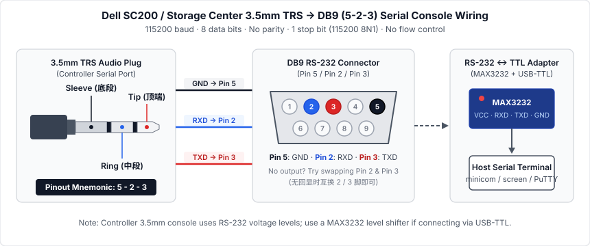
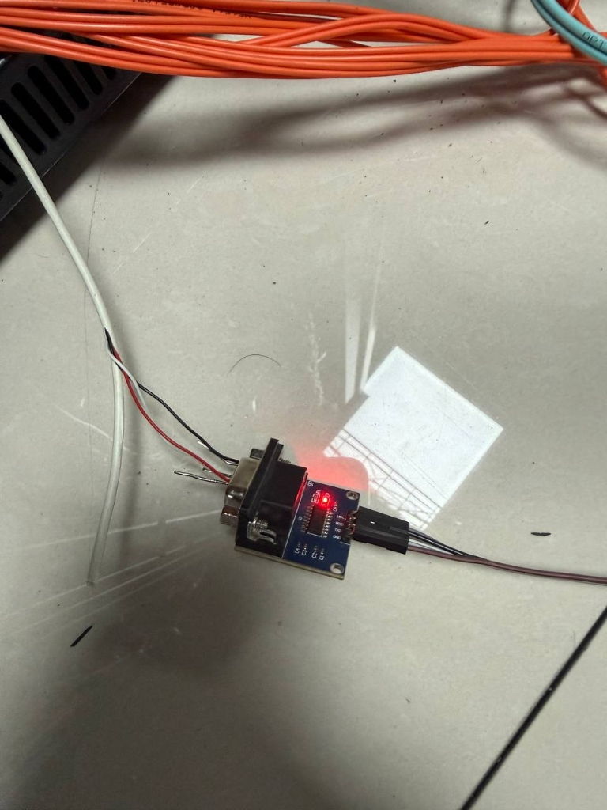

A Dell SC200 failed to boot after an unexpected power outage. Without an OEM serial cable around, I threw together a 3.5mm TRS console cable with a MAX3232 module to get in and bring it back up. Writing down the pinout and commands here for future reference.

## 3.5mm Audio Jack Console Cable (5-2-3)

The controller serial port uses a 3.5mm TRS jack at RS-232 voltage levels. Cut a regular 3-pole 3.5mm audio cable and wire it to DB9 using the **5-2-3** pinout (put a MAX3232 board in front if your laptop only has a USB-TTL adapter):

| 3.5mm TRS Segment | DB9 Pin | Signal |
| :--- | :--- | :--- |
| Sleeve (base) | Pin 5 | GND |
| Ring (middle) | Pin 2 | RXD |
| Tip (end) | Pin 3 | TXD |

Serial settings are `115200 8N1`, no flow control. If there is no output or input doesn't register, swap pins 2 and 3.



How it looked rigged up on site with the MAX3232 board:



## Safe Mode Recovery

After the power loss, two configuration files were left on the controller. The original password stopped working and the system would only drop into Safe Mode.

One catch: **plugging in a USB drive to reset the password does not work before initialization finishes**, so there is no point trying that first.

Log in over serial using the Safe Mode credentials:

```text
__safemode__
StorageCenterSafeMode
```

Once in, run `answer question 0` and pick the latest configuration file. The controller will load it and boot normally.
