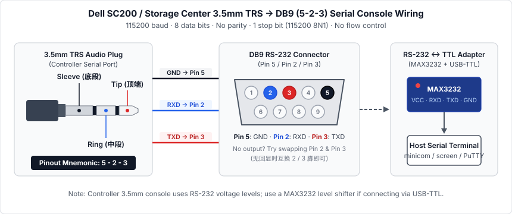
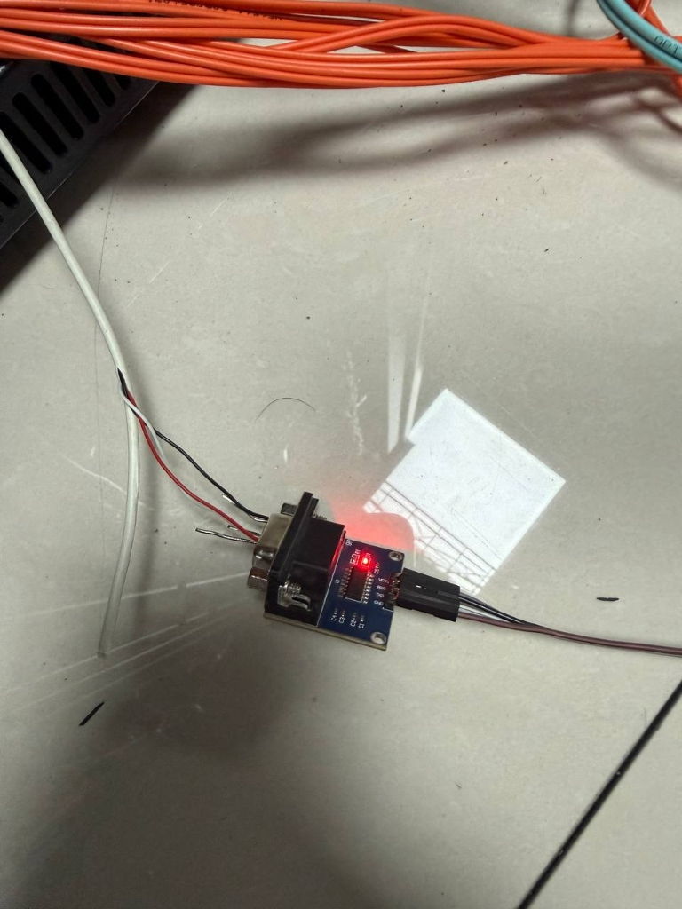

Dell SC200 异常断电之后起不来，手头没有原装串口线，临时拿一根 3.5mm 耳机线和 MAX3232 模块搓了一根 Console 线连上去修好的，记一下过程免得以后忘了。

## 3.5mm 耳机孔 Console 线（5-2-3）

控制器的串口是 3.5mm TRS 耳机孔，RS-232 电平。直接剪一根普通三段式 3.5mm 音频线，按 **5-2-3** 接到 DB9 上（用 USB-TTL 的话前面挂一块 MAX3232 转一下电平）：

| 3.5mm 插头段位 | DB9 引脚 | 信号 |
| :--- | :--- | :--- |
| Sleeve（底段，靠塑胶） | Pin 5 | GND |
| Ring（中段） | Pin 2 | RXD |
| Tip（顶端） | Pin 3 | TXD |

波特率 `115200 8N1`，无流控。如果连上没回显或者打不进字，把 2 和 3 脚对调就行。



现场就这么直接插在 MAX3232 的 DB9 针脚上凑合用的：



## 安全模式恢复

异常断电后控制器里同时留了两份配置文件，原本的登录密码直接失效，只能进安全模式。

有一点比较坑：**在初始化完成之前，插 U 盘重置密码是行不通的**，别在这上面浪费时间。

直接串口进安全模式登录：

```text
__safemode__
StorageCenterSafeMode
```

登进去之后执行 `answer question 0`，选最新的那份配置文件，控制器就能正常启动起来了。
